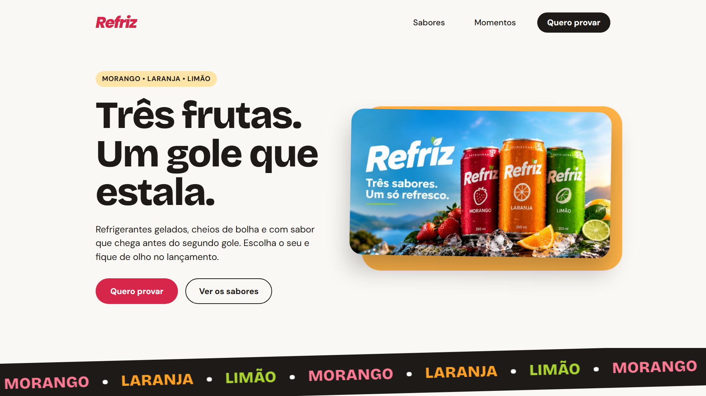
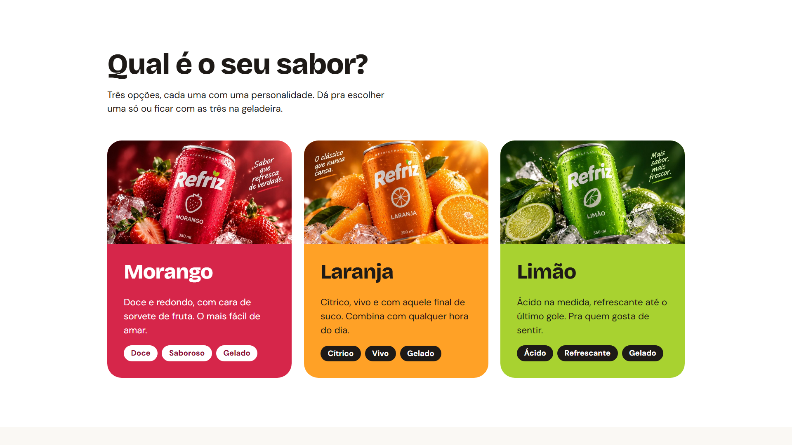

# WebNest Refriz

Uma landing page demonstrativa para a marca Refriz, desenvolvida pela WebNest para apresentar três sabores de refrigerante: morango, laranja e limão. O projeto combina imagens de produto, cores vibrantes e uma interface moderna para destacar a identidade visual da marca.

Versão 1.0.2

🔗 **Acesse o projeto:** [WebNest Refriz](https://gabriel-silira.github.io/WebNest-Refriz/)

---

## 📸 Imagens do Site

### Página inicial



### Sabores disponíveis



---

## 🚀 Funcionalidades

- **Apresentação da marca:** seção inicial com destaque para a Refriz e seus três sabores.
- **Navegação por seções:** acesso às áreas de sabores, momentos e interesse.
- **Faixa animada de sabores:** destaque visual para Morango, Laranja e Limão.
- **Cards de produtos:** apresentação individual de cada sabor, com imagens, descrições e características.
- **Seção de momentos:** apresentação de diferentes ocasiões para aproveitar os refrigerantes.
- **Formulário de interesse:** campos para informar o e-mail e selecionar o sabor favorito.
- **Identidade visual por sabor:** cores específicas para diferenciar os refrigerantes.
- **Animações e transições:** efeitos visuais que complementam a experiência de navegação.

> **Observação:** o formulário é demonstrativo e não possui envio de dados confirmado.

---

## 🛠️ Tecnologias utilizadas

| Tecnologia   | Aplicação                               |
| ------------ | --------------------------------------- |
| HTML5        | Estrutura e conteúdo da página          |
| CSS3         | Estilização, layout, cores e animações  |
| Git e GitHub | Versionamento e gerenciamento do código |

---

## 📂 Estrutura do projeto

```text
WebNest-Refriz/
├── assets/
│   ├── hero.jpg
│   ├── morango.jpg
│   ├── laranja.jpg
│   │── limao.jpg
├   ├── logo.png
│   └── demo/
│       ├── hero.png
│       └── sabores.png
├── style/
│   └── style.css
├── index.html
└── README.md
```

---

## 🎯 Objetivo do projeto

Este projeto foi desenvolvido para compor o portfólio da WebNest, explorando a criação de uma landing page para uma marca de bebidas.

O desenvolvimento envolve a organização de conteúdo, a construção de uma identidade visual consistente, a apresentação de produtos e a criação de uma interface que valoriza a experiência do usuário.

---

**Desenvolvido por [Gabriel Silira](https://github.com/gabriel-silira) | WebNest**
